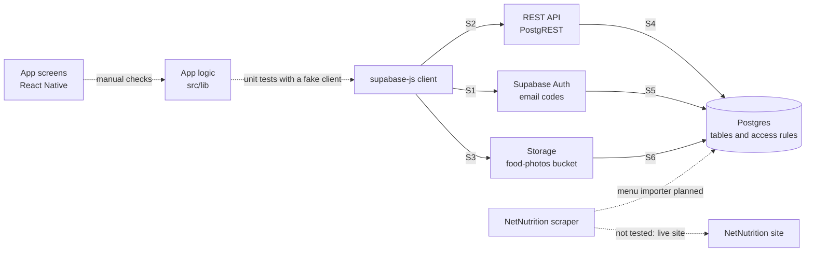

# Integration tests

Unit tests (Jest, `apps/mobile/src/lib/__tests__`) check app logic with the
Supabase client replaced by a fake. Integration tests check that the pieces work
together against a real Supabase stack (Auth, the REST API, Storage, and
Postgres) running locally or in CI. The checks run as ordinary users with no service-role
key, so they go through the same access rules as the app. Only the database tests'
setup data is inserted as the database owner.

- **Database tests** (pgTAP, `supabase/tests/database/*.test.sql`): run inside
  Postgres as a signed-in, unverified, or signed-out user. Each file rolls back.
- **Backend tests** (Jest, `apps/mobile/scripts/backend.integration.ts`): two
  test accounts sign in with real emailed codes and call Supabase through
  supabase-js, as the app does.

Run them locally with `npx supabase test db` (repository root) and
`npm run test:backend` (`apps/mobile`); see [testing](testing.md). CI runs both in
the "Integration tests (local Supabase)" check; see [pipeline](pipeline.md).

## Component map

Solid arrows are tested by integration tests; dashed arrows are not (yet).

| Seam | Between | Tested by |
| --- | --- | --- |
| S1 | supabase-js → Auth | Backend tests (real emailed codes, sign-out) |
| S2 | supabase-js → REST API | Backend tests |
| S3 | supabase-js → Storage | Backend tests |
| S4 | REST API → Postgres access rules | Backend tests and pgTAP |
| S5 | Auth → Postgres (campus email rule, verified membership) | pgTAP and backend tests |
| S6 | Storage → Postgres (upload rules, photos referenced by posts) | Backend tests and pgTAP |
| — | Screens → `src/lib` | Manual checklist in [testing](testing.md); no UI test library yet |
| — | `src/lib` → supabase-js | Unit tests with a fake client |
| — | Scraper → NetNutrition, scraper → database | Not yet: parser tests on saved pages and the menu importer are planned |

**Strategy: bottom-up.** We test the database rules first (pgTAP), then the
app-to-backend layer on top of them, because the access rules in Postgres are what
keep data private and valid, and every feature above them depends on them.

## Backend tests

From `apps/mobile/scripts/backend.integration.ts`. Every test goes through
supabase-js into the real local stack with nothing faked in between. ✗ marks a
failure-path test (invalid input, constraint violation, or unauthorized).

| Test | Seam | What it checks |
| --- | --- | --- |
| **Sign-in and access** | | |
| ✗ rejects sign-up with a non-Vanderbilt email | S1, S5 | A code can't be requested for an outside email address |
| ✗ denies anonymous feed reads | S2, S4 | Signed-out users can't read posts |
| signs in with an emailed code and saves a profile | S1, S2, S4 | A code from the inbox signs in, and the saved display name reads back |
| members can read the seeded dining halls | S2, S4 | Signed-in members see the dining halls |
| ✗ cannot edit another member's profile | S2, S4 | Updating someone else's profile changes nothing |
| **Menu items** | | |
| members can read the seeded menu items with their dining hall | S2, S4 | Dishes read back joined to their dining hall |
| ✗ denies anonymous menu reads | S2, S4 | Signed-out users can't read dishes |
| ✗ members cannot add menu items | S2, S4 | Members can't insert dishes (only the importer can) |
| **Profile rules** | | |
| ✗ rejects blank, whitespace-only, and 41-character display names | S2, S4 | Display name rules, at and past the boundary |
| accepts a 40-character display name | S2, S4 | The longest allowed name is saved |
| **Photo storage** | | |
| ✗ cannot upload into another user's folder | S3, S6 | Uploads are limited to your own folder |
| ✗ rejects non-image uploads | S3 | Only images are accepted |
| an unused upload can be removed | S3, S6 | A photo not used by a post can be deleted, and is gone afterward |
| **Publishing a post** | | |
| ✗ cannot post as another author | S2, S4 | A post can't claim someone else as its author |
| ✗ cannot forge the post timestamp | S2, S4 | The client can't set `created_at` |
| publishes a post that another member can read with its photo | S2, S3, S4 | The stored post reads back for a second member with its caption, and its photo link works |
| ✗ anonymous users cannot get photo links | S3, S6 | Signed-out users can't get photo URLs |
| ✗ a published photo cannot be removed | S3, S6 | A photo used by a post can't be deleted |
| **Post rules** | | |
| ✗ a post must reference an uploaded photo | S2, S4, S6 | A post without an uploaded photo is rejected |
| ✗ the dining hall must exist | S2, S4 | A post for an unknown hall is rejected |
| ✗ the photo path must match the post id | S2, S4 | The photo path must belong to that post |
| captions are limited to 280 characters, and the server sets the timestamp | S2, S4 | 281 characters is rejected; the stored 280-character post gets a server timestamp |
| an omitted caption defaults to an empty string | S2, S4 | The stored caption is empty, not null |
| the author filter excludes other authors | S2, S4 | Filtering by author returns only that author's posts |
| the hall filter excludes other halls | S2, S4 | Filtering by hall returns only that hall's posts |
| post detail joins the author and dining hall | S2, S4 | The detail query returns the author's name and the hall's name |
| ✗ published posts cannot be edited or deleted, even by their author | S2, S4 | Edits and deletes are rejected, and the stored caption is unchanged |
| **Sign-out** | | |
| ✗ signing out removes access | S1, S2 | After sign-out, reading posts fails |

## Database tests

From `supabase/tests/database/`. Each file runs its checks as different kinds of
users inside one transaction that rolls back.

| File | Checks | Seam | What it checks |
| --- | --- | --- | --- |
| `campus_email.test.sql` | 12 | S5 | The campus email rule: accepted addresses, letter case, and rejected look-alike domains, subdomains, empty or spaced local parts, and extra `@` signs |
| `membership.test.sql` | 9 | S4, S5 | Only verified campus accounts are members: unverified accounts can't read data or create profiles, emails can't change to another domain, and profile IDs can't be reassigned |
| `menu_items.test.sql` | 11 | S4 | One dish name per hall, a dish must belong to a real hall, name length limits, and only members can read dishes (nobody in the app can add, change, or delete them) |

## Keeping this up to date

Add a row when a pull request adds an integration test. Open pull requests add
ratings (#14), dining hall hours (#16), and posts that name a dish (#17).
