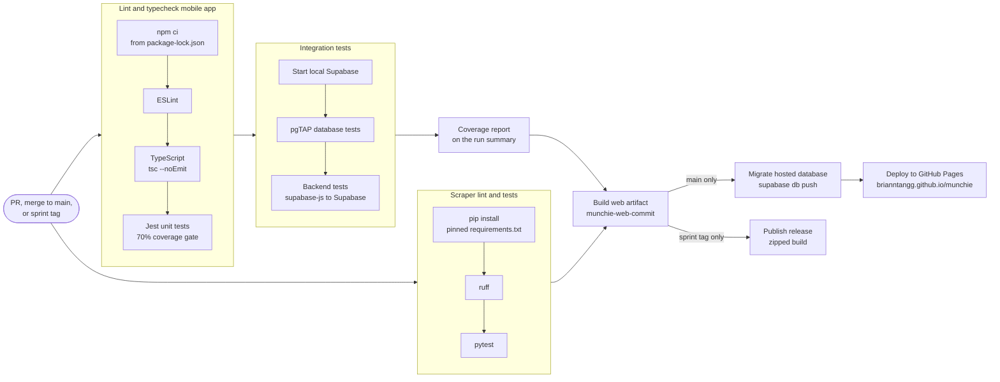

# CI/CD pipeline

Defined in [`.github/workflows/ci.yml`](../.github/workflows/ci.yml) (GitHub Actions).
For what the integration tests cover, see [integration tests](integration-tests.md).

## When it runs

| Event | What runs |
| --- | --- |
| Pull request (opened or updated) | All checks; no build |
| Merge to `main` | All checks, the web build artifact, hosted database migrations, then a deploy to GitHub Pages |
| Sprint tag pushed (e.g. `sprint3`) | All checks, the web build, then a GitHub release |

## Stages

Each stage waits for the one before it, and the run stops at the first failure.

| Stage (job) | What it does | Fails when |
| --- | --- | --- |
| Lint and typecheck mobile app | `npm ci` from the lock file, ESLint, `tsc --noEmit`, then Jest unit tests with coverage | Lint or type errors, a failing unit test, or coverage of `src/lib` below 70% |
| Integration tests (local Supabase) | Starts Supabase in the runner, runs the pgTAP database tests, then the backend tests through supabase-js | A database rule or an app-to-backend check fails |
| Coverage report | Posts a statements/branches/functions/lines table to the run summary | Integration tests failed, so it is skipped |
| Scraper lint and tests | Installs pinned Python requirements, runs ruff, then pytest on saved pages | Lint errors or a failing parser test |
| Build web artifact (merge or tag only) | Exports the web app and uploads it as `munchie-web-<commit>` (or `munchie-web-<tag>`), plus a `/munchie` build for GitHub Pages | Any check failed, so it is skipped |
| Migrate hosted database (main only) | Lists pending migrations, then applies them to the hosted Supabase project with `supabase db push` | A credential in the `production` environment is missing, or a migration fails against the hosted database |
| Deploy to GitHub Pages (main only) | Publishes the Pages build to <https://brianntangg.github.io/munchie> | The build or the migration failed, so it is skipped and the previous site stays up |
| Publish release (tag only) | Zips the build and publishes it as a GitHub release named after the tag | The build failed, so it is skipped |

Unit and integration tests are separate jobs, so a red check shows which layer
broke. Tests never call paid or external services: the backend runs in the CI
runner, email codes are read from Supabase's local inbox, and scraper tests use
saved pages instead of the live NetNutrition site. The only secrets are the
hosted database credentials, which only the migration job can read (see
[hosted migrations](#hosted-migrations)); the deploy uses GitHub's built-in Pages token.

## Continuous delivery

Every merge to `main` that passes all checks is deployed to
<https://brianntangg.github.io/munchie>, backed by a hosted Supabase project.
The same run uploads a versioned, runnable web build (`munchie-web-<commit>`);
the steps to run it are in the [README](../README.md#run-a-release-build).
Sprint tags also publish it as a
[release](https://github.com/brianntangg/munchie/releases). Tag runs do not
deploy, because the `github-pages` environment only accepts `main`.

The build reads the hosted project from the repository variables
`EXPO_PUBLIC_SUPABASE_URL` and `EXPO_PUBLIC_SUPABASE_PUBLISHABLE_KEY` (both public).
If they are unset, it builds against local Supabase instead and skips the Pages
deploy. The Pages build sets `EXPO_BASE_URL=/munchie` (read by
`apps/mobile/app.config.js`) so assets load from the subpath, and copies
`index.html` to `404.html` so deep links survive a refresh. The release build
stays at the root.

Tests never touch the hosted project; database changes reach it only through
the migration job, never with seed data (see
[hosted development](architecture.md#hosted-development)).

### Hosted migrations

On each merge to `main`, the migration job applies new migrations to the hosted
database after the build and before the Pages deploy. If a migration fails, the
deploy is skipped and the previous site keeps running against the unchanged
database. Fix the migration in a new pull request; a merged migration is never edited.

The previous site runs against the new schema for the minute between the
migration and the deploy, so migrations must be additive (see
[database changes](architecture.md#database-changes)). Only one migration job
runs at a time; a queued run applies every pending migration.

The job reads its credentials from the `production` environment
(**Settings → Environments**), which accepts deployments only from `main`, so
pull request runs cannot read them:

| Name | Kind | Value |
| --- | --- | --- |
| `SUPABASE_ACCESS_TOKEN` | Secret | A personal access token from [Supabase account tokens](https://supabase.com/dashboard/account/tokens) |
| `SUPABASE_DB_PASSWORD` | Secret | The hosted database password (**Project Settings → Database**) |
| `SUPABASE_PROJECT_REF` | Variable | The project ref, the subdomain in `EXPO_PUBLIC_SUPABASE_URL` |

If any of them is missing, the migration job fails with an error naming it and
the site does not deploy.

## Protecting `main`

Branch protection on `main` requires:

- a pull request, with one approving review from a teammate (stale approvals are
  dismissed when new commits are pushed)
- the CI checks to pass, on a branch that is up to date with `main`
- resolved review conversations
- no force pushes or deletions, and the same rules for administrators

Branch protection applies only to `main`, so stacked pull requests are merged
only after their base has merged and GitHub has retargeted them to `main` (see
[Contributing](../README.md#contributing)).
