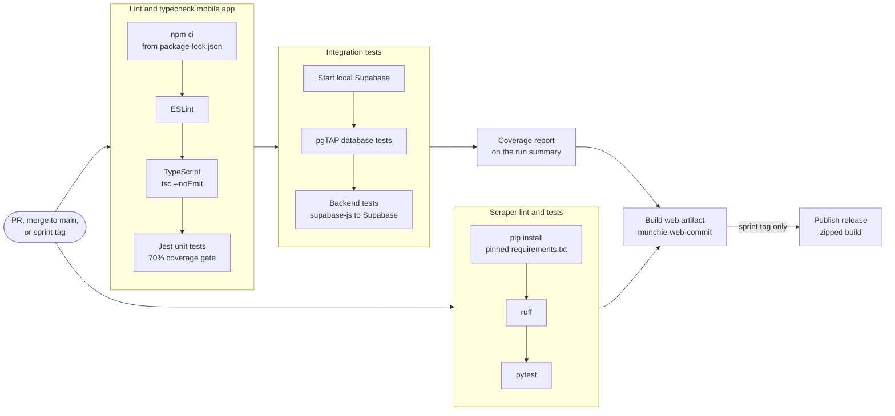

# CI/CD pipeline

Defined in [`.github/workflows/ci.yml`](../.github/workflows/ci.yml) (GitHub Actions).
For what the integration tests cover, see [integration tests](integration-tests.md).

## When it runs

| Event | What runs |
| --- | --- |
| Pull request (opened or updated) | All checks; no build |
| Merge to `main` | All checks, then the web build artifact |
| Sprint tag pushed (e.g. `sprint3`) | All checks, the web build, then a GitHub release |

## Stages

Each stage waits for the one before it, and the run stops at the first failure.

| Stage (job) | What it does | Fails when |
| --- | --- | --- |
| Lint and typecheck mobile app | `npm ci` from the lock file, ESLint, `tsc --noEmit`, then Jest unit tests with coverage | Lint or type errors, a failing unit test, or coverage of `src/lib` below 70% |
| Integration tests (local Supabase) | Starts Supabase in the runner, runs the pgTAP database tests, then the backend tests through supabase-js | A database rule or an app-to-backend check fails |
| Coverage report | Posts a statements/branches/functions/lines table to the run summary | Integration tests failed, so it is skipped |
| Scraper lint and tests | Installs pinned Python requirements, runs ruff, then pytest on saved pages | Lint errors or a failing parser test |
| Build web artifact (merge or tag only) | Exports the web app and uploads it as `munchie-web-<commit>` (or `munchie-web-<tag>`) | Any check failed, so it is skipped |
| Publish release (tag only) | Zips the build and publishes it as a GitHub release named after the tag | The build failed, so it is skipped |

Unit and integration tests are separate jobs, so a red check shows which layer
broke. Tests never call paid or external services: the backend runs in the CI
runner, email codes are read from Supabase's local inbox, and scraper tests use
saved pages instead of the live NetNutrition site. The repository holds no
secrets.

## Continuous delivery

Every merge to `main` produces a versioned, runnable web build. It is built
against local Supabase, so it runs anywhere with `npx supabase start`; the steps
are in the [README](../README.md#run-a-release-build). Sprint tags also publish
it as a [release](https://github.com/brianntangg/munchie/releases).

Setting the repository variables `EXPO_PUBLIC_SUPABASE_URL` and
`EXPO_PUBLIC_SUPABASE_PUBLISHABLE_KEY` points the build at a hosted project
instead, with no workflow change. Hosting is planned for a later sprint.

## Protecting `main`

Branch protection on `main` requires:

- a pull request, with one approving review from a teammate (stale approvals are
  dismissed when new commits are pushed)
- the CI checks to pass, on a branch that is up to date with `main`
- resolved review conversations
- no force pushes or deletions, and the same rules for administrators

Branch protection applies only to `main`, so stacked pull requests are merged
only after their base has merged and GitHub has retargeted them to `main` (see
[Contributing](../README.md#contributing)).
