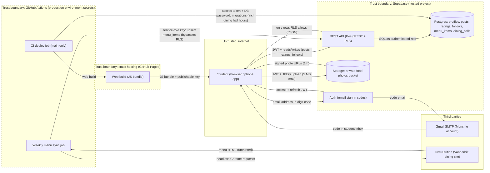

# Threat model: Munchie (Group 3)
Last updated: 2026-11-11 · Authors: Brian, David, Justin, Tevin · Covers: main @ 76f6709 + production https://brianntangg.github.io/munchie (no separate staging; local Supabase is our test environment)

## 1. Data-flow diagram (DFD)
Dashed subgraphs are trust boundaries. Every arrow is labelled with the data that crosses it.

Boundaries used below: **B1** GitHub Pages -> Browser, **B2** Browser -> Supabase Auth, **B3** Browser -> REST/Postgres, **B4** Browser <-> Storage, **B5** GitHub Actions -> Supabase, **B6** NetNutrition -> menu sync.

## 2. Assets (what an attacker wants)
| Asset | Where it lives | Why it matters |
|-------|----------------|----------------|
| User accounts / sessions | Supabase Auth; JWT + refresh token in the app's localStorage | A stolen session lets someone post, rate and follow as a student |
| Personal data (Vanderbilt emails, display names, posts, photos, who follows whom) | Postgres (`auth.users`, `profiles`, `posts`, `follows`), Storage `food-photos` | Members-only by design; leaking it exposes students outside campus |
| API keys: Supabase service-role key, Supabase access token, DB password, Gmail app password | GitHub `production` environment secrets; Supabase SMTP settings | Service-role key and DB password bypass every RLS rule; Gmail password sends mail as Munchie |
| Rating and feed integrity | `ratings`, `posts` tables | Fake or altered ratings make dish averages meaningless (the app's core value) |
| Menu and hours data | `menu_items` (weekly sync), `dining_halls.hours` (loaded by migration) | Wrong menus/hours mislead students; lower impact |
| Money / quota (free tiers) | Supabase free tier (DB, 1 GB storage, egress), Gmail ~500 emails/day | Exhausting quota takes the app or sign-in down for everyone |

## 3. STRIDE table
| # | Boundary (A -> B) | STRIDE | Asset | Threat (one sentence) | Existing control | Gap? -> Finding ID |
|---|-------------------|--------|-------|-----------------------|------------------|--------------------|
| T1 | B2 Browser -> Auth | S | Accounts / sessions | An attacker requests a code for a victim's email and brute-forces the 6-digit code. | Codes are single-use and expire; Supabase limits code verifications per IP (30 / 5 min in `supabase/config.toml`; hosted value not yet confirmed). | Yes: no CAPTCHA, expiry is 1 h, hosted limits still to be checked in the dashboard -> **F1** |
| T2 | B2 Browser -> Auth | D | Gmail quota | A script requests codes for many `@vanderbilt.edu` addresses so the ~500/day Gmail limit runs out and real students cannot sign in. | `docs/email-delivery.md` sets the hosted email limit to 60/hour and Supabase spaces repeat codes to one address (hosted values not yet confirmed). | Yes: no CAPTCHA, single sending account, hosted limits still to be checked -> **F1** |
| T3 | B2 Browser -> Auth | E | Personal data | Someone without a Vanderbilt email (or with an unconfirmed one) signs up and reads members-only content. | `require_campus_email()` trigger on sign-up and email change; every policy calls `private.is_member()` (confirmed `@vanderbilt.edu`, not anonymous); covered by pgTAP. | No |
| T4 | B3 Browser -> REST | T | Feed / rating integrity | A member edits the request body to set `author_id`, `follower_id` or `created_at` and posts, rates or follows as someone else. | `with check` policies require `author_id` / `follower_id` to equal `auth.uid()` (posts grant `author_id`, so the policy is what protects it); ratings and follows don't grant the author column at all; `created_at` is never granted and defaults to `now()`; pgTAP + integration tests. | No |
| T5 | B3 Browser -> REST | E | Feed / rating integrity | A member changes an ID in a request to update another student's rating, unfollow on their behalf, or (Sprint 4) edit/delete their post, like or comment. | Update/delete policies require `author_id`/`follower_id = auth.uid()`; ratings cannot be deleted; tested for ratings and follows. | Yes for new Sprint 4 tables/actions (likes, comments, edit/delete posts, multi-photo) -> **F2** |
| T6 | B1 Pages -> Browser, B3 | I | Personal data | Anyone copies the publishable key from the public JS bundle and queries the REST API directly while signed out. | `revoke all ... from anon`; all policies are `to authenticated` and require `is_member()`. | No |
| T7 | B3 Browser -> REST | R | Feed integrity | A member posts an offensive photo or caption, later denies it, and no one can report or remove it. | `author_id` and `created_at` are set server-side, so authorship is recorded. | Yes: no report/removal flow (Story 18 not built) -> **F5** |
| T8 | B4 Browser -> Storage | D | Storage quota | A member uploads thousands of 5 MB JPEGs that are never attached to posts and fills the 1 GB free tier. | Bucket allows JPEG only, 5 MB max, own folder only. | Yes: no upload rate limit or orphan cleanup -> **F4** |
| T9 | B4 Storage -> Browser | I | Photos | A member forwards a signed photo URL to people outside campus. | Bucket is private; signed URLs expire after 1 h. | Accepted (low impact) |
| T10 | B5 GitHub Actions -> Supabase | E / I | Service-role key, DB password | A compromised third-party action or a workflow edited on a branch prints or sends out the service-role key / DB password and bypasses all RLS. | Secrets live in the `production` environment, which only allows protected branches (only `main`); `permissions: contents: read`; branch protection on `main`. | Yes: third-party actions pinned to tags, not commit SHAs -> **F3** |
| T11 | B1 Pages -> Browser | T | Accounts / sessions | A malicious npm dependency ends up in the web build and steals session tokens from localStorage. | `package-lock.json` + `npm ci`; deploy only from `main` after lint/typecheck/tests. | Yes: no Dependabot or `npm audit` in CI -> **F3** |
| T12 | B6 NetNutrition -> sync | T | Menu data | NetNutrition changes or serves bad HTML and the sync writes junk or script-like text into menus. | `import_menus.py` trims and length-checks names/categories; React Native renders text, never HTML; the sync writes only `menu_items` (hours arrive through a reviewed migration). | Accepted (low impact) |

## 4. OWASP Top 10:2025 checklist -- owner per category
| Category | Owner | What we checked (where) | Result: pass / finding (ID) / N/A + reason |
|----------|-------|-------------------------|--------------------------------------------|
| A01 Broken Access Control | David | Tried another member's IDs on posts, ratings, follows; RLS in `supabase/migrations/*`, tests in `supabase/tests/database/*.test.sql` and `apps/mobile/scripts/backend.integration.ts` | Pass for current tables; **F2** for Sprint 4 tables |
| A02 Security Misconfiguration | Brian | `supabase/config.toml` vs hosted dashboard (CAPTCHA off, OTP expiry 1 h, rate limits); bucket is private | Finding **F1** (hosted auth settings set by hand, not recorded) |
| A03 Software Supply Chain Failures | Brian | `package-lock.json`, `npm ci`, workflow `uses:` lines in `.github/workflows/` | Finding **F3** (no Dependabot/`npm audit`; actions not SHA-pinned) |
| A04 Cryptographic Failures | Tevin | HTTPS on GitHub Pages and Supabase; passwordless sign-in (no passwords stored); signed photo URLs | Pass |
| A05 Injection (SQL, XSS, command) | Justin | supabase-js / PostgREST parameterized queries; captions and menu names rendered as React Native text; scraper writes through supabase-py | Pass |
| A06 Insecure Design | David | No moderation or post removal; orphan uploads; re-rating changes stars on older posts | Findings **F4**, **F5** |
| A07 Authentication Failures | Tevin | Email-code sign-in, campus-email trigger, session refresh, sign-out (`src/lib/auth.tsx`, auth screens) | Finding **F1** (no CAPTCHA; brute-force/spam limits not reviewed) |
| A08 Software or Data Integrity Failures | Brian | Deploy only from `main` after checks; migrations applied before deploy; secrets in the `production` environment, which only `main` can use | Finding **F3** (pin actions to commit SHAs) |
| A09 Security Logging & Alerting Failures | Tevin | Supabase dashboard auth/API logs; GitHub Actions failure emails | Finding **F6** (short log retention on free tier, no alert on sign-in spikes) |
| A10 Mishandling of Exceptional Conditions | Justin | `src/lib/*` throws on Supabase errors and screens show a banner + Retry; duplicate rating (23505) handled; failed menu sync fails the workflow | Pass |

### Findings
| ID | Summary | Owner |
|----|---------|-------|
| F1 | Sign-in abuse: no CAPTCHA, 1 h code expiry, hosted rate limits not reviewed or recorded | Tevin |
| F2 | Sprint 4 tables/actions (likes, comments, edit/delete posts, multi-photo) need RLS + pgTAP ownership tests before merge | David |
| F3 | CI/CD and supply chain: pin third-party actions to commit SHAs, add Dependabot and `npm audit` | Brian |
| F4 | No upload rate limit or cleanup of photos never attached to a post | Justin |
| F5 | No way to report or remove inappropriate posts | David |
| F6 | No alerting on unusual sign-in or error volume | Tevin |
| F7 | Comment flooding: nothing limited comment writes, so one member saved 100 comments in 1.1 s against local Supabase (STRIDE D, OWASP Insecure Design). Fixed: at most 10 comments per member per minute, enforced by a database trigger; regression tests in `comment_rate_limit.test.sql` and `backend.integration.ts` | Justin |

## 5. Top 3 risks and next actions
1. **F1 Sign-in abuse (T1, T2).** Turn on Supabase CAPTCHA (hCaptcha or Turnstile) for sign-in, shorten code expiry to 10 minutes, review hosted rate limits, and record the hosted auth settings in `docs/email-delivery.md`. Owner: Tevin.
2. **F2 Access rules for Sprint 4 features (T5).** Every new table or action (likes, comments, edit/delete posts, multi-photo) ships with RLS policies that use `is_member()` and `auth.uid()` ownership, plus pgTAP tests that another member is rejected. Owner: David.
3. **F3 CI secrets and supply chain (T10, T11).** Pin third-party actions to commit SHAs, and add Dependabot and `npm audit --audit-level=high` to CI. (The `production` environment is already limited to `main`.) Owner: Brian.
